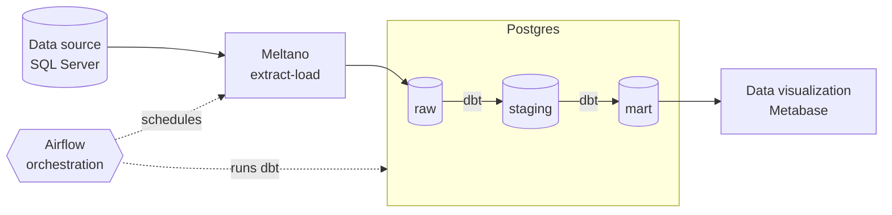

# Bike Store Data Warehouse

Proof of concept of a small data warehouse for a bike store: the store's SQL Server database is loaded into a PostgreSQL warehouse, cleaned and modelled with dbt, scheduled with Airflow, and shown to the owner in a Metabase dashboard (revenue, revenue trend, orders by status, revenue by category).




## Contents

1. [Stack](#stack)
2. [Repository layout](#repository-layout)
3. [Quick start](#quick-start)
4. [How the pipeline works](#how-the-pipeline-works)
5. [Data model](#data-model)
6. [Running parts by hand](#running-parts-by-hand)
7. [Known limitations](#known-limitations)

---

## Stack

All services run with Docker Compose.

| Component  | Role                                                                                 | URL / port            |
|------------|--------------------------------------------------------------------------------------|-----------------------|
| SQL Server | Source system, loaded with the BikeStores sample                                     | `localhost:1433`      |
| PostgreSQL | Warehouse (`dwh`) + app databases (`meltano`, `metabase`, `airflow`)                 | `localhost:5432`      |
| Meltano    | Extract-load SQL Server → `raw`                                                      | –                     |
| dbt        | `raw` → `staging` (views) → `mart` (tables), tests                                   | –                     |
| Airflow    | Scheduling; Meltano and dbt are installed in its image and run inside its containers | http://localhost:8080 |
| Metabase   | Owner dashboard                                                                      | http://localhost:3000 |

## Repository layout

```
.
├── docker-compose.yaml          
├── Makefile                  # make run / stop / down / clean
├── .env / .env.example          
├── db_script/                # Bike store init script   
├── mssql/                       
├── postgres/                  
├── meltano/                  # Meltano configuration   
├── dbt/
│   └── analytics/               
│       ├── dbt_project.yml, profiles.yml
│       ├── macros/              
│       ├── models/staging/   # Staging
│       └── models/mart/      # Mart
├── airflow/
│   ├── Dockerfile               
│   └── dags/bike_store.py       
├── metabase/                   
```

## Quick start

**Prerequisites:** 

```bash
cp .env.example .env   
make run               # build + start everything
make schedule          # after the first run is green: turn on the weekly full reload
```

Then open Airflow at http://localhost:8080 (`admin` / `admin`) and Metabase at http://localhost:3000 (dashboard setup: [`metabase/README.md`](metabase/README.md)).

| Command | What it does |
|---|---|
| `make up` | Build the images and start all services |
| `make run` | `make up`, wait for Airflow, then unpause and trigger `bike_store_daily` |
| `make schedule` | Unpause `bike_store_weekly_full_reload` (only after the first daily load) |
| `make status` | Containers + latest daily runs |
| `make stop` | Stop all containers — keeps containers and data (`make up` resumes) |
| `make down` | Remove all containers — keeps the data volumes |
| `make clean` | Remove all containers **and all data** (warehouse, Metabase dashboards, Airflow history); asks for confirmation |

## How the pipeline works

### DAGs

| DAG | Schedule (UTC) | Extract-load |
|---|---|---|
| `bike_store_daily` | 01:00 every day | `meltano run el-incremental` — small tables full reload, `orders` / `order_items` incremental on `order_id` |
| `bike_store_weekly_full_reload` | 03:00 Sunday | `meltano run el-orders-full` — full reload of `orders` / `order_items` (picks up status changes) |
| `bike_store_full_refresh` | manual | `meltano run --full-refresh el-incremental` — reload everything (first load, recovery) |

Every DAG runs the same steps; a failing step stops the rest, so the dashboard keeps the last good data:

```
extract_load ─► run_staging ─► test_staging ─► run_mart ─► test_mart
 (Meltano)      (dbt run)      (dbt test)      (dbt run)   (dbt test)
```

### Why "daily incremental + weekly full reload"

- The source tables have no `updated_at` column. Loading orders incrementally by `order_id` picks up **new** orders every day but not **status changes** on existing ones (Pending → Completed). 
- The weekly full reload of the order tables corrects them. Result: new orders are at most 1 day old, order status at most 7 days old — enough for a business-health dashboard.

### Layers

| Schema | Built by | Content |
|---|---|---|
| `raw` | Meltano (`target-postgres`, upsert on source primary keys) | 9 tables as in the source + `_sdc_*` load metadata |
| `staging` | dbt (views) | 9 `stg_*` models: renamed, typed, trimmed, status codes → labels |
| `mart` | dbt (tables) | Star schema for the dashboard |

## Data model

`mart` — grain: one row per order line item.

| Table | Content |
|---|---|
| `fct_order_items` | Keys (order, item, date, product, customer, store, staff, status), `quantity`, `list_price`, `discount`, `gross_amount`, `discount_amount`, `net_revenue`, `is_booked`, `is_completed`, `booked_revenue`, `completed_revenue`, `order_extracted_at` |
| `dim_date` | Calendar (year, quarter, month, week, weekday) |
| `dim_product` | Product with brand and category |
| `dim_customer`, `dim_store`, `dim_staff` | Descriptive attributes (staff with manager name) |
| `dim_order_status` | Pending / Processing / Rejected / Completed with the revenue flags |

Revenue definitions:

- `net_revenue = quantity × list_price × (1 − discount)`, using the line's own price.
- **Booked revenue** (headline KPI) = all orders except Rejected.
- **Completed revenue** = Completed orders only (can lag for recent orders until the weekly reload).


## Running parts by hand

Meltano and dbt are installed in the Airflow image; run them by hand in the scheduler container (same installation as the scheduled runs). Don't run these while an Airflow run is active:

```bash
# Meltano
docker compose exec airflow-scheduler meltano config test tap-mssql
docker compose exec airflow-scheduler meltano run el-incremental
docker compose exec airflow-scheduler meltano state get dev:tap-mssql-to-target-postgres

# dbt
docker compose exec airflow-scheduler dbt debug
docker compose exec airflow-scheduler dbt run  --select staging
docker compose exec airflow-scheduler dbt test --select staging
docker compose exec airflow-scheduler dbt run  --select mart
docker compose exec airflow-scheduler dbt test --select mart
```

What needs a rebuild after a change: [`TROUBLESHOOTING.md`](TROUBLESHOOTING.md#after-changing-files).

## Known limitations

This is a proof of concept; these are accepted trade-offs:

- **Status lag:** order status and completed revenue can be up to 7 days old (weekly full reload).
- **Deletes** in the source are not propagated to the warehouse.
- **Dashboard:** plain SQL cards, no dashboard filters; trend cards fixed to Jan 2016 – Apr 2018 (the sample data effectively ends in April 2018).
 self-signed SQL Server certificate.
- **One Postgres instance** for the warehouse and all app metadata (Meltano, Metabase, Airflow).
- **No alerting:** failed Airflow tasks are only visible in the UI.
- **SCD:** not available for SCD 2, just only SCD 1
